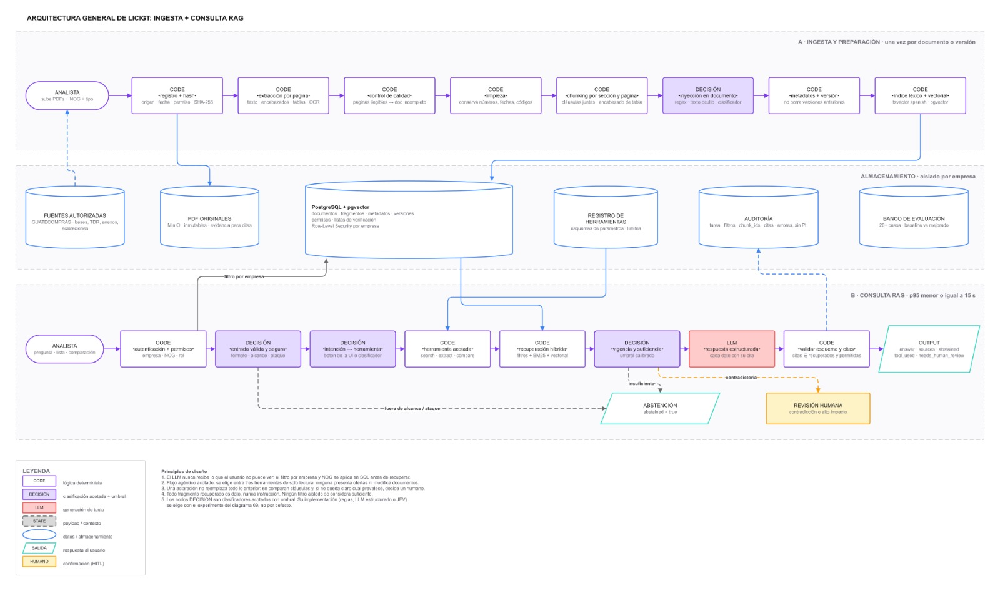

# Anteproyecto — Proyecto Final CC3103

## 1. Información general

**Título:** LiciGT: sistema inteligente para analizar licitaciones públicas en Guatemala mediante RAG.

**Integrantes:**

- Edwin Jose
- Gustavo Cruz
- Josue Say — 22801
- Mathew Cordero — 22982

**Dominio:** análisis de bases, términos de referencia, anexos y aclaraciones de licitaciones públicas.

**Usuario primario:** analistas de licitaciones de empresas guatemaltecas proveedoras del Estado.

**Problema y propuesta de valor:** revisar manualmente documentos extensos y sus modificaciones consume tiempo y puede dejar requisitos sin detectar. LiciGT permitirá cargar los PDF de una licitación y consultar requisitos, documentos obligatorios y fechas límite; cada respuesta y elemento de la lista de verificación mostrará su fuente y página.

**Fuentes previstas:** bases de licitación, términos de referencia, anexos y aclaraciones publicados en [GUATECOMPRAS](https://www.guatecompras.gt/), además de la normativa disponible en su [repositorio de legislación](https://www.guatecompras.gt/info/legislacion.aspx). Se verificará la versión vigente de cada documento antes de usarla.

**Posible comprador:** empresas proveedoras registradas en GUATECOMPRAS, como constructoras, distribuidoras y consultoras. Una suscripción mensual es una opción comercial futura; pagos y suscripciones quedan fuera del MVP.

**Demostración de valor:** comparar el tiempo de revisión, la cobertura de requisitos y la validez de las citas de LiciGT frente a una revisión manual, además de contrastar el RAG básico y el mejorado sobre el mismo banco de pruebas.

**Riesgo principal y mitigación:** una respuesta incorrecta, una cita inválida o una modificación omitida puede inducir una oferta incompleta. El sistema conservará versiones, validará citas, se abstendrá sin evidencia y escalará contradicciones o casos de alto impacto a revisión humana.

## 2. Resumen Ejecutivo

Las empresas guatemaltecas que participan en licitaciones públicas deben revisar y verificar requisitos distribuidos entre bases, anexos, especificaciones, aclaraciones y modificaciones publicadas en GUATECOMPRAS, cuyo incumplimiento puede ocasionar el rechazo de sus ofertas. Para atender esta problemática, se propone desarrollar LiciGT, un sistema basado en RAG que permita analizar documentos de licitación, identificar requisitos obligatorios, comparar modificaciones y generar listas de verificación con referencias a las fuentes originales. El sistema estará dirigido al personal responsable de preparar ofertas en empresas proveedoras del Estado, especialmente pequeñas y medianas empresas, con el propósito de evaluar si esta tecnología reduce el tiempo de revisión y las omisiones documentales, manteniendo precisión, trazabilidad y seguridad frente a instrucciones maliciosas presentes en los documentos.

## 3. Problema

### Situación actual

Actualmente, las empresas que participan en licitaciones públicas de Guatemala deben revisar diferentes documentos publicados en GUATECOMPRAS para identificar los requisitos y condiciones necesarios para presentar sus ofertas. 

### Dolor o limitación

La principal dificultad es identificar y verificar todos los requisitos de una licitación, debido a que la información está distribuida en varios documentos que pueden contener aclaraciones o modificaciones. 

### Impacto

Esta dificultad puede aumentar el tiempo y los recursos necesarios para preparar ofertas, además de generar omisiones que podrían provocar su rechazo y la pérdida de oportunidades comerciales.

### Pregunta principal del sistema

¿Cómo facilitar la identificación y verificación de los requisitos de una licitación pública mediante el análisis de sus documentos?

## 4. Usuario Y Contexto

LiciGT está dirigido a empresas guatemaltecas proveedoras del Estado, especialmente pequeñas y medianas empresas. Su usuario principal será el personal encargado de analizar las bases de licitación y preparar las ofertas. El sistema se utilizará durante la revisión de documentos y la verificación de requisitos antes de presentar una propuesta.

 

| Usuario | Necesidad | Permisos | Riesgo de error |
| :---- | :---- | :---- | :---- |
| *Analista de licitaciones o encargado de preparar ofertas de una empresa proveedora del Estado.* | *Identificar requisitos obligatorios, documentos solicitados, fechas límite y cambios distribuidos entre las bases, anexos y aclaraciones de una licitación.* | *Cargar y consultar documentos en el espacio de su empresa, realizar preguntas y generar listas de verificación. Sin acceso a documentos privados de otras empresas ni permisos para presentar ofertas en GUATECOMPRAS.* | *Una respuesta incorrecta o incompleta podría causar omisiones, incumplimiento de requisitos o vencimiento de plazos, lo que podría provocar el rechazo de la oferta.* |

## 5. Objetivos

### Objetivo general

*Desarrollar y evaluar un sistema basado en generación aumentada por recuperación (RAG) que facilite la identificación y verificación de requisitos de licitaciones públicas en Guatemala, mediante el análisis de sus documentos y la generación de respuestas y listas de verificación con referencias a las fuentes originales.*

### Objetivos específicos

1. *Implementar un proceso de carga, extracción e indexación de documentos PDF de licitaciones que conserve metadatos de documento, versión y página para permitir la trazabilidad de la información recuperada.*  
     
2. *Desarrollar un módulo de consulta y generación de listas de verificación que identifique requisitos obligatorios, documentos solicitados, fechas límite y modificaciones, respaldando cada elemento con citas verificables e indicando cuándo no exista evidencia suficiente.*  
     
3. *Evaluar el sistema mediante un banco de pruebas con respuestas de referencia y casos sin respuesta o con instrucciones maliciosas, midiendo la precisión de la información, la validez de las citas, la abstención y el tiempo de revisión frente a una revisión manual.*  
   

## 6. Alcance

### Incluye

* Carga y procesamiento de documentos PDF de licitaciones públicas de Guatemala.  
* Extracción, limpieza, segmentación e indexación de documentos con metadatos.  
* Búsqueda semántica o híbrida mediante RAG.  
* Consultas en lenguaje natural sobre requisitos, fechas y condiciones de participación.  
* Identificación de requisitos obligatorios y generación de listas de verificación.  
* Respuestas fundamentadas con referencias al documento, página y versión.  
* Flujo agéntico para decidir entre consultar documentos, extraer requisitos o verificar información mediante herramientas.  
* Validación de entradas, salidas y permisos de acceso.  
* Protección y pruebas frente a prompt injection, alucinaciones y consultas sin evidencia.  
* Evaluación de precisión, recuperación, latencia, costos y seguridad, comparando una versión básica con una mejorada.

### No incluye

* Presentación automática de ofertas en GUATECOMPRAS.  
* Generación completa de propuestas económicas o técnicas.  
* Garantía de aceptación o adjudicación de licitaciones.  
* Sustitución de asesoría legal o revisión profesional.  
* Modificación de documentos oficiales.  
* Procesamiento de información confidencial sin autorización.  
* Monitoreo automático de todas las licitaciones nacionales.  
* Integraciones comerciales, pagos o suscripciones en la primera versión.

### MVP

Desarrollar un prototipo funcional de LiciGT que permita cargar documentos PDF de licitaciones públicas, procesarlos mediante un pipeline de NLP y consultar sus requisitos utilizando RAG. El sistema deberá identificar requisitos obligatorios, generar una lista de verificación y proporcionar respuestas respaldadas por fuentes verificables. Incorporará un flujo agéntico limitado para seleccionar entre búsqueda documental y validación de requisitos, además de controles básicos de seguridad frente a instrucciones maliciosas y respuestas sin evidencia.

**Hipótesis central:** Un sistema RAG especializado puede reducir el tiempo necesario para identificar requisitos de licitaciones públicas, manteniendo respuestas precisas y verificables.

**Validación mínima:** Comparar un RAG básico con una versión mejorada, utilizando al menos 20 casos de prueba, y medir recuperación, precisión de respuestas, trazabilidad, latencia y resistencia a ataques de prompt injection.

## 7. Fuentes Y Gobernanza

| Fuente | Formato | Propietario | Actualización | Permiso | Sensibilidad |
| :---- | :---- | :---- | :---- | :---- | :---- |
| *Bases de licitación y términos de referencia publicados en GUATECOMPRAS.* | *PDF y documentos anexos.* | *Entidad pública convocante.* | *Al incorporar una licitación al sistema.* | *Lectura y consulta.* | *Pública.* |
| *Anexos, aclaraciones y modificaciones de cada licitación.* | *PDF y otros archivos publicados.* | *Entidad pública convocante.* | *Al revisar nuevas publicaciones del concurso.* | *Lectura y consulta.* | *Pública.* |
| *Ley de Contrataciones del Estado y su reglamento, disponibles en el repositorio de legislación de GUATECOMPRAS.* | *PDF o HTML.* | *Organismo emisor de cada norma.* | *Al verificar reformas o nuevas versiones oficiales.* | *Lectura y consulta.* | *Pública.* |
| *Documentos internos cargados por las empresas, si se incluyen en el alcance.* | *PDF.* | *Empresa que carga los documentos.* | *Cada vez que un usuario autorizado carga una versión.* | *Acceso exclusivo de usuarios autorizados de la empresa.* | *Privada o confidencial.* |

**Cómo se conservarán versiones, metadatos y permisos**

**Versiones:** Se conservará cada documento original con un identificador único, su fecha de incorporación y una huella digital (*hash*) para detectar archivos duplicados o cambios. Las nuevas versiones se almacenarán sin sobrescribir las anteriores. Las aclaraciones y modificaciones se vincularán con la licitación correspondiente para permitir su comparación.

**Metadatos:** Cada documento registrará el Número de Operación GUATECOMPRAS (NOG), título, entidad convocante, tipo de documento, fecha de publicación, URL de origen, versión y fecha de carga. Cada fragmento utilizado por el sistema conservará también el identificador del documento y la página de origen para generar citas verificables.

**Permisos:** El acceso requerirá autenticación y se limitará según el rol del usuario y la empresa a la que pertenece. Los documentos internos y sus fragmentos indexados solo podrán recuperarse por usuarios autorizados de esa empresa. El sistema registrará las cargas y consultas para facilitar la auditoría.

## 8. Requisitos

### Funcionales

1. **Carga y procesamiento de documentos:** el sistema permitirá cargar documentos PDF de una licitación, extraer su contenido e indexarlo, conservando la referencia al documento y la página de origen.
2. **Consultas con evidencia:** el sistema permitirá realizar preguntas sobre requisitos, documentos obligatorios, fechas y condiciones de participación. Cada respuesta incluirá citas al documento y página correspondientes e indicará cuando no exista información suficiente para responder.
3. **Lista de verificación:** el sistema generará una lista de requisitos y documentos obligatorios con sus citas, permitirá marcar su cumplimiento e identificará cambios entre las bases y las aclaraciones o modificaciones cargadas.

### No funcionales

Las siguientes son **metas propuestas para el MVP**, que deberán comprobarse durante la evaluación:

1. **Tiempo de respuesta:** al menos el 95 % de las consultas deberá responderse en un máximo de 15 segundos, con los documentos previamente procesados e indexados.
2. **Concurrencia:** el sistema deberá admitir al menos cinco usuarios realizando consultas simultáneamente, sin mezclar documentos, respuestas ni listas de verificación entre sus sesiones.
3. **Seguridad y configuración:** las credenciales deberán almacenarse fuera del código fuente y el acceso a documentos deberá validarse en cada consulta según los permisos del usuario. La aplicación deberá poder desplegarse mediante un procedimiento documentado que especifique sus dependencias y variables de entorno.

## 9. Arquitectura

La arquitectura separa dos flujos. **Ingesta**, una vez por documento o versión: analista → registro y hash → extracción por página (texto, tablas y OCR cuando haga falta) → control de calidad → limpieza → segmentación → decisión de inyección en documento → metadatos y versión → índices léxico y vectorial. Si una página resulta ilegible o el documento está incompleto, se registra el fallo y se solicita revisión antes de indexarla como evidencia confiable. Los PDF originales se conservan en MinIO con versionado y protección contra sobrescritura para poder contrastar cualquier cita.

**Consulta**, por pregunta: analista → autenticación y permisos → validación de entrada → enrutamiento de intención → herramienta acotada → recuperación híbrida filtrada por empresa y NOG → decisión sobre vigencia y suficiencia → generación estructurada → validación de esquema, citas y permisos → respuesta. Una consulta fuera de alcance, un ataque o la falta de evidencia conduce a abstención. Las contradicciones entre versiones y los resultados de alto impacto se envían a revisión humana.

El estado compartido de cada consulta contendrá `tenant_id`, usuario, rol, NOG, intención, herramientas llamadas, identificadores de fragmentos recuperados y estado de validación. El modelo solo recibirá fragmentos autorizados y nunca decidirá por sí mismo los permisos. PostgreSQL con `pgvector` guardará documentos, fragmentos, versiones, índices y listas de verificación; las políticas de acceso por fila y los filtros por `tenant_id` y NOG se aplicarán antes de recuperar texto. El registro de herramientas limitará los parámetros y el número de llamadas. Una bitácora separada guardará trazas sanitizadas y el banco de evaluación permitirá repetir las pruebas.

La [asignación de roles y carpetas de trabajo](../roles/Asignacion_de_roles.md) distribuye la construcción de estos componentes entre cuatro integrantes y deja un espacio para que cada uno escriba su nombre.

### Componentes

| Componente | Función | Entrada | Salida | Justificación |
| :---- | :---- | :---- | :---- | :---- |
| Interfaz y autenticación | Recibir cargas y consultas; asociar usuario, rol y empresa | PDF, NOG, pregunta o acción sobre checklist | Solicitud autenticada | Vincula cada operación con un responsable y su ámbito de acceso. |
| Registro y almacenamiento original | Validar archivo, calcular SHA-256 y conservar el PDF en MinIO | PDF y metadatos de origen | `doc_id`, hash y objeto inmutable | Permite deduplicar y contrastar citas con el original. |
| Extracción y control de calidad | Extraer texto y tablas por página; usar OCR si es necesario y marcar páginas ilegibles | PDF original | Texto por página, tablas y alertas | Evita indexar silenciosamente contenido incompleto. |
| Limpieza y segmentación | Normalizar ruido sin alterar números, fechas ni códigos; dividir por cláusulas y tablas | Texto con páginas | Fragmentos con sección y páginas | Conserva la unidad semántica de los requisitos. |
| Control de inyección documental | Marcar patrones de instrucciones ajenas al documento y aislar el texto como dato | Fragmentos extraídos | Fragmentos clasificados y alertas | Reduce el riesgo de que un PDF controle el flujo de consulta. |
| Versionado e índices | Persistir metadatos, permisos, vectores y texto buscable en PostgreSQL con `pgvector` | Fragmentos, embeddings y NOG | Índices y relaciones de versión | Hace posible recuperar evidencia filtrada y comparar cambios. |
| Enrutador y registro de herramientas | Clasificar la intención y permitir solo herramientas, parámetros y pasos autorizados | Pregunta y estado de consulta | Plan acotado y resultados de herramientas | Limita el flujo agéntico a tareas verificables. |
| Recuperación y control de evidencia | Buscar, fusionar, reordenar y verificar vigencia y suficiencia | Consulta, empresa y NOG | Fragmentos candidatos con páginas y versión | Aporta evidencia antes de generar respuestas. |
| Generación y validación | Producir el contrato JSON y comprobar esquema, citas, permisos y conflictos | Evidencia autorizada | Respuesta, abstención o solicitud de revisión | Impide publicar afirmaciones sin respaldo verificable. |
| Auditoría y evaluación | Guardar eventos sin datos sensibles y ejecutar casos reproducibles | Eventos, preguntas y respuestas de referencia | Trazas y métricas | Permite diagnosticar fallas y comparar versiones. |

## 10. Recuperación Y RAG

* **Estrategia de chunking:**  
  1. Línea base: ventana fija de 512 tokens con solapamiento de 50.  
  2. Versión mejorada: corte por estructura. Primero se separa por títulos, numerales y cláusulas de las bases (por ejemplo “Artículo”, “Numeral”, “Anexo”). Los segmentos largos se dividen recursivamente en ventanas de aproximadamente 800 tokens con solapamiento de 120 (15 %), cortando en límites de párrafo u oración. Las tablas (listas de documentos, especificaciones técnicas) se extraen como Markdown y se indexan como chunks independientes. Un chunk nunca mezcla documentos distintos y conserva las páginas que abarca.  
* **Metadatos:** cada fragmento guarda el siguiente esquema.

| Campo | Descripción |
| ----- | ----- |
| `chunk_id`, `doc_id` | Identificadores únicos del fragmento y del documento |
| `nog`, `titulo`, `entidad` | Número de Operación GUATECOMPRAS, título de la licitación y entidad convocante |
| `tipo_documento` | bases, términos de referencia, anexo, aclaración, modificación, ley o reglamento |
| `version`, `fecha_publicacion`, `hash_sha256`, `url_origen` | Versión, fecha de publicación, huella del archivo y URL de origen |
| `pagina_inicio`, `pagina_fin`, `seccion` | Ubicación dentro del documento (numeral o título) |
| `tipo_chunk` | texto o tabla |
| `tenant_id`, `visibilidad` | Empresa propietaria y si es pública o privada, para el control de acceso |

* **Modelo de embeddings:**  
  1. Línea base: `paraphrase-multilingual-MiniLM-L12-v2` (384 dimensiones).  
  2. Versión mejorada: `BAAI/bge-m3` (1024 dimensiones, multilingüe, contexto de hasta 8192 tokens). Se eligió por su buen desempeño en español y porque se ejecuta localmente, de modo que los documentos no salen de la infraestructura.  
* **Índice:** PostgreSQL con `pgvector`, índice HNSW (`m=16`, `ef_construction=64`) y distancia coseno. Cada variante de embeddings tendrá su propia columna o índice por usar dimensiones distintas. Para la parte léxica, una columna `tsvector` con configuración `spanish` e índice GIN. Se usa una sola base de datos para vectores, metadatos y permisos, lo que permite filtrar por `tenant_id` y `nog` dentro de la misma consulta.  
* **Búsqueda:** los documentos del concurso se filtran por empresa y NOG. La normativa pública, si se incorpora al corpus, se consulta en un índice separado y con su versión explícita; no se presenta como si fuera una cláusula de la licitación.  
  1. Línea base: solo semántica, top-5.  
  2. Versión mejorada: híbrida. Se recuperan 20 candidatos semánticos y 20 léxicos mediante `tsvector` y `ts_rank_cd`, ambos ya filtrados por empresa y licitación. Se fusionan con Reciprocal Rank Fusion (`k = 60`) con pesos 0.6 para lo semántico y 0.4 para lo léxico. La parte léxica es importante porque las consultas incluyen términos exactos como “fianza de cumplimiento”, NOG, números de artículo y montos.  
* **Reranking:** cross-encoder `BAAI/bge-reranker-v2-m3` sobre los 20 mejores candidatos fusionados, de los cuales se conservan 5. Si un numeral tiene versión original y una aclaración o modificación posterior, se muestran ambas y se marca el cambio para revisión; no se presume que toda aclaración sustituya automáticamente la base. Se aplica diversidad con MMR para reducir fragmentos casi idénticos.  
* **Citas:** cada fragmento entra al contexto etiquetado con su `chunk_id`. El modelo debe devolver, para cada afirmación, el `chunk_id` y una cita textual breve. Un validador determinista comprueba que la cita aparece literalmente en el fragmento (normalizando espacios y mayúsculas) y que su documento, página y versión siguen autorizados. La interfaz la muestra como Documento · versión · página. Una coincidencia textual no demuestra por sí sola que la interpretación sea correcta; los casos ambiguos se marcan para revisión humana. Las afirmaciones sin cita válida se descartan o se regeneran una vez.  
* **Abstención:** el sistema responde “No se encontró evidencia suficiente en los documentos cargados” cuando ocurre cualquiera de estos casos:  
  1. el mejor puntaje del reranker, normalizado a una escala de 0 a 1, queda por debajo de un umbral τ calibrado con un subconjunto de desarrollo para equilibrar abstenciones correctas e indebidas;  
  2. no hay ningún fragmento de la licitación consultada (NOG) entre los recuperados;  
  3. el validador de citas no logra respaldar ninguna afirmación de la respuesta;  
  4. se pregunta por una fecha o monto y ningún fragmento recuperado contiene un patrón de fecha o cantidad.

## 11. Herramientas Y Agentes

 

| Herramienta | Propósito | Parámetros | Permisos | Validación |
| ----- | ----- | ----- | ----- | ----- |
| buscar\_documentos | Recuperación híbrida con reranking dentro de una licitación | query: str (≤500), nog: str, tipo\_documento?: enum, k: int (1–10) | Rol analista o lector; solo documentos de su empresa y públicos | Previa: esquema (pydantic), NOG numérico y existente. Posterior: todos los chunks pertenecen al tenant; el texto recuperado se trata como datos, no como instrucciones |
| extraer\_requisitos | Listar requisitos obligatorios y documentos solicitados | nog: str, categoria?: enum (legal, técnico, financiero, administrativo) | Rol analista | Salida JSON con esquema fijo; cada requisito exige chunk\_id, página y cita textual verificada; los que no pasan se eliminan |
| extraer\_fechas | Obtener fechas límite (ofertas, visita técnica, aclaraciones, apertura) | nog: str | Rol analista | Fechas en formato ISO con zona America/Guatemala; chequeo de coherencia (por ejemplo, la presentación es posterior a la publicación); cita obligatoria |
| comparar\_versiones | Detectar cambios entre bases y aclaraciones o modificaciones | nog: str, doc\_base\_id: str, doc\_modif\_id: str | Rol analista | Ambos documentos del mismo NOG y del mismo tenant; la modificación debe ser posterior a la base; cada cambio cita ambas versiones |
| verificar\_cita | Comprobar que una afirmación está sustentada por un fragmento | chunk\_id: str, cita: str | Interna del sistema | Coincidencia literal normalizada; devuelve valida o no\_valida y el motivo |
| generar\_checklist | Consolidar requisitos y fechas verificados en una lista de verificación | nog: str, incluir\_modificaciones: bool | Rol analista; escribe solo en el espacio de su empresa | Solo incluye ítems con cita verificada; marca como “pendiente de revisión” los que tienen conflicto entre versiones |

**Por qué cada herramienta es necesaria**

* buscar\_documentos es la base de todas las demás: sin recuperación filtrada y trazable no hay evidencia.  
* extraer\_requisitos y extraer\_fechas están separadas porque tienen validaciones distintas. Los requisitos son texto con criterios de obligatoriedad, mientras que las fechas exigen formato, zona horaria y coherencia temporal, donde un error implica perder el plazo.  
* comparar\_versiones cubre el dolor central del problema: los requisitos cambian entre las bases y las aclaraciones, y revisar eso a mano es lo que causa omisiones.  
* verificar\_cita actúa como filtro de alucinaciones antes de mostrar nada al usuario.  
* generar\_checklist produce el entregable final y solo usa información ya verificada por las otras herramientas.

**Orquestación y límites:** El enrutador seleccionará una de tres rutas: consulta documental, extracción o comparación. Permitirá como máximo tres llamadas de herramienta por pregunta y una regeneración si falla la validación. Las herramientas no podrán navegar a URLs arbitrarias, ejecutar comandos ni modificar documentos oficiales. `generar_checklist` solo escribirá en el espacio de la empresa autenticada. Si una herramienta falla, se devolverá una respuesta de error controlada o una abstención; no se inventará el resultado.

**Contrato de salida:** Toda respuesta seguirá un esquema validado con `answer` (texto), `sources` (lista de `source`, `page`, `chunk_id` y versión), `abstained` (booleano), `tool_used` (nombre o `null`) y `needs_human_review` (booleano). Si `abstained` es verdadero, `answer` explicará que no hay evidencia suficiente; si hay versiones contradictorias, `needs_human_review` será verdadero y se mostrarán ambas fuentes.

## 12. Evaluación

### Banco de pruebas

Se construirá un conjunto inicial de **20 casos**, siguiendo la distribución mínima del enunciado del curso: cinco preguntas directas, tres paráfrasis, tres consultas con identificadores exactos, tres preguntas compuestas, dos ambiguas, dos sin respuesta en el corpus y dos dependientes de la versión o fecha de publicación. Cada caso tendrá `id`, `question`, `expected_behavior`, `expected_sources`, `expected_pages`, `answerable` y `risk_level`. Las respuestas de referencia se anotarán a partir de PDF originales; una segunda revisión resolverá discrepancias de páginas, interpretación y vigencia.

Las fuentes esperadas serán las bases, anexos, aclaraciones y modificaciones de licitaciones públicas incorporadas al corpus, con NOG, documento, versión y página. Los dos casos sin respuesta exigirán abstención. Los dos de vigencia exigirán identificar el documento posterior y, cuando corresponda, explicar el cambio sin ocultar la versión original. Se preparará además una **suite de seguridad separada de al menos ocho casos**, con inyección en pregunta y PDF, evasión entre empresas, solicitud de acción no permitida y alucinación forzada. Habrá casos de parámetros inválidos y fallo de herramienta. Cada prueba adversaria documentará amenaza, componente, conducta esperada, resultado observado y mitigación.

La línea base y la versión mejorada se ejecutarán sobre los mismos documentos y preguntas, con versiones del corpus, modelos, parámetros y código fijadas. Se registrarán resultados por caso y errores, además de los promedios. La comparación con revisión manual se hará sobre una muestra de tareas cronometradas, con instrucciones iguales y verificación de cobertura; al ser una muestra pequeña, el resultado se presentará como evidencia exploratoria.

### Métricas

Las metas siguientes son **criterios propuestos de aceptación del MVP**, no resultados ya obtenidos. Los umbrales de abstención y de reranking se calibrarán solo con un subconjunto de desarrollo; el conjunto final se reservará para la comparación.

| Métrica | Definición | Meta propuesta | Método de cálculo |
| :---- | :---- | :---- | :---- |
| Recall@5 | Porcentaje de preguntas respondibles cuya evidencia esperada aparece entre los cinco primeros fragmentos | ≥ 85 % | Casos con al menos un fragmento esperado en top-5 / casos respondibles. |
| MRR@5 | Posición del primer fragmento relevante | ≥ 0.70 | Promedio de `1/rango` del primer acierto; cero si no aparece en top-5. |
| Cobertura de requisitos | Requisitos esperados presentes en el checklist | ≥ 90 % | Requisitos correctos encontrados / requisitos de referencia. |
| Fidelidad factual | Afirmaciones respaldadas por evidencia y correctamente interpretadas | ≥ 90 % | Afirmaciones correctas / afirmaciones evaluadas, con revisión humana de una muestra y desglose de errores. |
| Validez de citas | Citas que corresponden al documento, página, versión y texto indicado | ≥ 95 % | Citas válidas / citas emitidas, verificadas automáticamente y auditadas manualmente. |
| Abstención | Respuestas sin evidencia que se abstienen correctamente | 2 de 2 casos mínimos | Casos sin respuesta con `abstained=true` / casos sin respuesta; reportar también abstenciones indebidas. |
| Latencia P95 | Tiempo desde la pregunta hasta la respuesta, con documentos ya indexados | ≤ 15 s | Percentil 95 de tiempos por consulta, con entorno y concurrencia registrados. |
| Costo operativo | Recursos consumidos por consulta | Reportar, sin umbral previo | Tokens, llamadas al modelo, tiempo de CPU/GPU y costo estimado por 100 consultas. |
| Resistencia a ataques | Pruebas adversarias bloqueadas sin fuga o acción indebida | 100 % en la suite inicial | Ataques bloqueados / ataques ejecutados; todo fallo se describe y corrige. |
| Tiempo de revisión | Tiempo para completar una tarea de identificación de requisitos | Reducción exploratoria ≥ 25 % | Comparación de medianas de tareas manuales y asistidas, con cobertura verificada. |

## 13. Seguridad

* **Prompt injection:** validar longitud y formato de la pregunta, distinguir instrucciones del sistema de texto recuperado, y tratar siempre los PDF y resultados de herramientas como datos no confiables. Marcar patrones sospechosos durante la ingesta y probar ataques directos e indirectos; los filtros por palabras son auxiliares, no la única defensa.
* **Documentos no autorizados:** autenticar al usuario y aplicar permisos por empresa y NOG antes de toda búsqueda o lectura del PDF original. Usar políticas de acceso por fila en PostgreSQL con un rol de aplicación sin privilegio para eludirlas como segunda barrera, y comprobar que ninguna cita provenga de otro `tenant_id`.
* **Información sensible:** el MVP utilizará documentos públicos o archivos internos expresamente autorizados. Los archivos privados se separarán por empresa; se enmascararán datos personales en registros y conjuntos de prueba cuando no sean necesarios. Las credenciales se mantendrán fuera del repositorio.
* **Herramientas y acciones críticas:** registrar nombres, esquemas y límites de las herramientas; máximo tres llamadas por consulta. El sistema no presentará ofertas ni ejecutará cambios externos. Una contradicción, una fecha crítica dudosa o un cambio de alto impacto activará `needs_human_review`; la decisión final corresponderá al analista.
* **Salidas inválidas:** validar el contrato JSON, la existencia y autorización de cada `chunk_id`, la coincidencia de las citas y el formato de fechas. Ante error, reintentar una sola vez o abstenerse. Una cita literal no reemplaza la revisión de interpretación jurídica o técnica.
* **Registros de auditoría:** registrar usuario o identificador seudonimizado, empresa, NOG, fecha, herramienta, identificadores de fragmentos, resultado de validación y error. Evitar guardar preguntas completas, texto de documentos privados, credenciales o datos personales en logs de aplicación.

## 14. Riesgos

| Riesgo | Probabilidad | Impacto | Mitigación | Prueba |
| :---- | :---- | :---- | :---- | :---- |
| Omisión de requisito por OCR o extracción deficiente | Media | Alto | Control de páginas ilegibles, extracción de tablas y revisión del PDF original | PDF escaneados y tablas en el banco; medir cobertura de requisitos. |
| Interpretación incorrecta de una cláusula pese a una cita literal | Media | Alto | Evidencia por afirmación, revisión humana para ambigüedad y advertencia de alcance | Auditoría manual de fidelidad y casos ambiguos. |
| Uso de una versión desactualizada | Media | Alto | Conservar todas las versiones, vincular modificaciones y mostrar conflictos | Dos casos temporales mínimos y comparación de documentos. |
| Acceso cruzado entre empresas | Baja | Alto | Filtro previo por empresa, políticas por fila y validación posterior de citas | Intentos de acceso con dos empresas y NOG compartido. |
| Inyección de instrucciones desde un PDF | Media | Alto | Aislar contenido recuperado, limitar herramientas y validar salida | Suite de ataques directos e indirectos. |
| Falta de evidencia o alucinación de fecha/monto | Media | Alto | Umbral de suficiencia, patrones de fecha/monto, abstención y revisión | Casos sin respuesta y solicitudes de datos inexistentes. |
| Latencia o costo excesivo del reranking y generación | Media | Medio | Limitar candidatos, contexto, llamadas y reintentos; medir por etapa | Prueba de cinco usuarios concurrentes, P95 y costo por consulta. |

## 15. Plan De Trabajo

Las semanas son **relativas al inicio de implementación** porque el enunciado consultado no fija aquí un calendario. Los nombres de quienes asumirán cada rol se escribirán en la [asignación de roles](../roles/Asignacion_de_roles.md).

| Fase | Actividad | Rol responsable | Entregable | Fecha relativa |
| :---- | :---- | :---- | :---- | :---- |
| Anteproyecto y corpus | Delimitar licitaciones, permisos, casos de uso y arquitectura; registrar versiones de fuentes | Roles 1 y 4 | Anteproyecto y manifiesto inicial del corpus | Semana 1 |
| Línea base | Implementar carga, extracción, segmentación fija y RAG semántico básico | Roles 1 y 2 | Prototipo y resultados iniciales reproducibles | Semana 2 |
| Mejora RAG | Incorporar segmentación estructural, índice léxico, fusión, reranking y citas | Rol 2, con apoyo del rol 1 | Pipeline mejorado y pruebas de recuperación | Semanas 3–4 |
| Herramientas y flujo | Integrar router, herramientas limitadas, contrato JSON y checklist | Rol 3, con apoyo del rol 4 | Flujo funcional con respuestas estructuradas | Semana 4 |
| Evaluación | Anotar 20 casos, comparar variantes y revisión manual; medir calidad, latencia y costo | Rol 4, con casos de todo el equipo | Dataset y reporte comparativo con errores | Semana 5 |
| Seguridad | Probar inyección, permisos, abstención y fallos de herramientas; corregir hallazgos | Rol 4, con correcciones de cada módulo | Matriz de pruebas adversarias y mitigaciones | Semana 5 |
| Demostración y defensa | Preparar ejecución en vivo, limitaciones, conclusiones y documentación final | Equipo completo | Informe, repositorio reproducible y presentación | Semana 6 |

## 16. Referencias

* [Enunciado del Proyecto Final CC3103: Sistema NLP/RAG Agéntico Empresarial](../presentaciones/Proyecto%20Final%20CC3103_%20Sistema%20NLP_RAG%20Ag%C3%A9ntico%20Empresarial-1.pdf). Requisitos, estructura del banco de pruebas y contrato de salida.
* [Diagrama de arquitectura de LiciGT](../arquitectura/arquitectura.jpeg). Flujos de ingesta, almacenamiento y consulta utilizados en este anteproyecto.
* [GUATECOMPRAS](https://www.guatecompras.gt/). Portal de origen de los concursos y documentos públicos.
* [GUATECOMPRAS: base legal y documentos relacionados](https://www.guatecompras.gt/info/legislacion.aspx). Repositorio de normativa que deberá verificarse por versión y fecha de vigencia.
* [PostgreSQL: funciones de búsqueda de texto](https://www.postgresql.org/docs/current/functions-textsearch.html). Referencia de `tsvector` y `ts_rank_cd`.
* [PostgreSQL: políticas de seguridad por fila](https://www.postgresql.org/docs/current/ddl-rowsecurity.html). Base del aislamiento entre empresas.
* [pgvector: documentación del proyecto](https://github.com/pgvector/pgvector). Índices vectoriales y HNSW en PostgreSQL.
* [Sentence Transformers: ficha de paraphrase-multilingual-MiniLM-L12-v2](https://huggingface.co/sentence-transformers/paraphrase-multilingual-MiniLM-L12-v2). Modelo propuesto para la línea base.
* [BAAI: ficha de BGE-M3](https://huggingface.co/BAAI/bge-m3). Modelo multilingüe propuesto para la versión mejorada.
* [BAAI: ficha de bge-reranker-v2-m3](https://huggingface.co/BAAI/bge-reranker-v2-m3). Modelo de reranking propuesto.
* [Repositorio del proyecto](https://github.com/donmatthiuz/NLP/tree/proyecto). Código y documentación de implementación.
