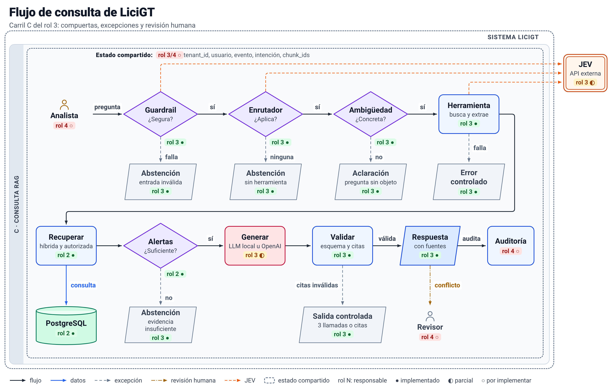

# Anteproyecto — Proyecto Final CC3103

## 1. Información general

**Título:** LiciGT: sistema inteligente para analizar documentos de licitaciones del Instituto Guatemalteco de Seguridad Social mediante RAG.

**Fecha de actualización:** 19 de noviembre de 2026 (reentrega).

**Integrantes:**

| Nombre | Carnet |
|---|---|
| Edwin Jose | 22809 |
| Gustavo Cruz | 22779 |
| Josue Say | 22801 |
| Mathew Cordero | 22982 |

**Dominio:** análisis documental de licitaciones del Instituto Guatemalteco de Seguridad Social (IGSS), con énfasis inicial en adquisiciones de medicamentos y requisitos administrativos, legales, técnicos y financieros para preparar ofertas.

**Cliente objetivo:** empresas que participan o desean participar como proveedoras del IGSS. El segmento inicial comprende distribuidoras, droguerías y empresas farmacéuticas cuyos equipos preparan ofertas de medicamentos. Una ampliación posterior podrá atender proveedores de insumos, equipo médico y servicios, previa incorporación y evaluación de documentos de esas categorías.

**Usuario primario:** analista de licitaciones o encargado de preparar ofertas dentro de una empresa proveedora del IGSS.

**Fuente documental principal:** sección [Proveedores del IGSS](https://www.igssgt.org/proveedores/) y archivos oficiales de licitaciones alojados en el sitio institucional. El proyecto utilizará carga manual de PDF obtenidos de esa fuente y conservará su URL de origen.

**Problema y propuesta de valor:** el analista debe localizar y relacionar requisitos dispersos entre bases, especificaciones, cronogramas y anexos del IGSS. LiciGT facilitará consultas sobre esos documentos y generará listas de verificación con referencias al documento, versión y página. En las adquisiciones de medicamentos, permitirá consultar condiciones documentales asociadas a códigos IGSS, presentaciones, concentraciones y demás especificaciones que aparezcan expresamente en el expediente.

**Posible comprador:** la gerencia comercial o administrativa de una empresa proveedora del IGSS. Una suscripción por empresa es una posibilidad comercial futura; el MVP se centrará en validar la utilidad del sistema. No se presupone un contrato, patrocinio o adopción por parte del IGSS.

**Demostración de valor:** comparar el tiempo de identificación de requisitos, su cobertura y la validez de las citas frente a una revisión manual; contrastar un RAG básico y una versión mejorada utilizando el mismo corpus y banco de preguntas.

**Riesgo principal:** generar una lista incompleta o interpretar incorrectamente una condición del concurso. Se mitigará mediante trazabilidad, control de versiones, advertencias de cobertura documental, abstención sin evidencia y revisión humana de contradicciones o resultados de alto impacto.

## 2. Resumen ejecutivo

Las empresas que participan en licitaciones del IGSS necesitan revisar documentos que reúnen condiciones administrativas, legales, financieras y técnicas, además de cronogramas y anexos. En el segmento farmacéutico, esta revisión exige relacionar los documentos de la oferta con el medicamento solicitado, su código institucional y las características especificadas para cada evento. Los documentos consultados del IGSS muestran esta estructura y distinguen requisitos fundamentales, no fundamentales y condiciones de presentación de ofertas [2, 3].

Se propone desarrollar LiciGT, un sistema de generación aumentada por recuperación (RAG) que permita cargar PDF oficiales obtenidos del portal de proveedores del IGSS, realizar consultas en lenguaje natural y generar listas de verificación respaldadas por citas. La primera evaluación se enfocará en licitaciones de medicamentos, para mantener un contexto de uso delimitado y construir respuestas de referencia verificables.

El sistema conservará los archivos originales, extraerá contenido por página, recuperará fragmentos del evento seleccionado y validará las referencias de cada respuesta. Cuando se disponga de aclaraciones o modificaciones oficiales, permitirá compararlas con los documentos anteriores. Si el conjunto cargado es incompleto, lo indicará expresamente y limitará sus conclusiones a la evidencia disponible.

El valor esperado consiste en apoyar al personal de las empresas proveedoras durante la preparación y revisión documental de sus ofertas. La evaluación determinará si el prototipo reduce el tiempo de revisión y las omisiones sin perder precisión, trazabilidad ni aislamiento entre empresas. Los resultados se presentarán como evidencia exploratoria del corpus evaluado.

## 3. Problema

### Situación actual

El portal de proveedores del IGSS publica eventos y archivos descargables organizados por año [1]. Los expedientes revisados incluyen bases, especificaciones generales y técnicas, disposiciones especiales y anexos [2, 3]. Un analista debe recorrer estas secciones para identificar qué documentos preparar, qué condiciones verificar y qué fechas atender.

En las licitaciones de medicamentos, el equipo de la empresa también debe identificar el producto solicitado y relacionar su código IGSS, presentación y demás especificaciones con los requisitos documentales del evento. Las condiciones deben extraerse del documento correspondiente: no puede suponerse que dos concursos con una estructura similar exijan exactamente lo mismo.

### Dolor o limitación

La dificultad central es consolidar información distribuida en varias páginas y documentos para obtener una lista de requisitos clara y verificable. La presencia de tablas, referencias entre numerales, formatos anexos y eventuales modificaciones aumenta el trabajo de lectura y contraste.

Las principales situaciones que abordará el proyecto son:

- Localizar requisitos de participación y documentos que debe contener la oferta.
- Distinguir requisitos fundamentales y no fundamentales cuando el expediente establezca esa clasificación.
- Relacionar el código y la descripción del producto con las condiciones solicitadas.
- Identificar fechas, horarios, lugares y plazos documentados.
- Comparar cambios entre una base y una modificación oficial disponible.
- Reconocer cuándo un archivo es solo una convocatoria o cuándo falta documentación para contestar.

### Impacto

Las omisiones o interpretaciones incorrectas pueden producir retrabajo, una oferta incompleta o el incumplimiento de condiciones de participación. El tiempo y la frecuencia de estos problemas deberán medirse durante el proyecto; no se presupone una tasa de error ni un ahorro previamente demostrado.

### Pregunta principal del sistema

¿Cómo facilitar la identificación y verificación de los requisitos documentales de las licitaciones del IGSS mediante el análisis de sus PDF oficiales y respuestas respaldadas por evidencia?

## 4. Cliente, usuario y contexto

### Descripción del cliente

El cliente objetivo es una empresa que comercializa medicamentos y prepara ofertas para procesos de adquisición del IGSS. Su equipo debe coordinar información comercial, administrativa y técnica para reunir los documentos exigidos por cada concurso. En empresas con equipos pequeños, una misma persona puede asumir varias de estas tareas.

La necesidad que se busca atender es disponer de una herramienta que transforme los documentos del evento en información consultable y en una lista de verificación trazable. La disposición de estas empresas a utilizar o pagar por la solución deberá validarse mediante entrevistas o pruebas de uso; todavía no se presenta como un resultado del proyecto.

El IGSS participa en este contexto como entidad convocante y fuente de los documentos. El producto se diseña inicialmente para el trabajo de preparación de ofertas de las empresas proveedoras.

### Usuarios y permisos

| Usuario | Necesidad | Permisos en el MVP | Riesgo de error |
|---|---|---|---|
| Analista de licitaciones de una empresa proveedora del IGSS | Identificar documentos, requisitos, fechas y cambios de un evento | Cargar PDF, consultar documentos y elaborar listas de verificación en su empresa | Omitir un requisito o utilizar una condición que no corresponde al evento |
| Responsable técnico o regulatorio de la empresa | Revisar especificaciones y documentación técnica exigida para el producto | Consultar evidencia y revisar los ítems que le correspondan | Confundir códigos, concentraciones, presentaciones o documentos requeridos |
| Supervisor comercial o administrativo | Revisar pendientes y organizar la preparación de la oferta | Consultar y revisar listas de verificación autorizadas | Interpretar una lista como garantía de aceptación o como expediente completo |

### Contexto de uso

1. El analista identifica una licitación en el portal de proveedores del IGSS.
2. Descarga los PDF oficiales disponibles y registra su origen.
3. Crea el evento en LiciGT, indicando modalidad, número institucional, año y unidad requirente cuando conste.
4. Carga los archivos y revisa las alertas de legibilidad, duplicados y cobertura.
5. Consulta requisitos y genera una lista de verificación con citas.
6. Contrasta los resultados con los originales y marca el avance de preparación documental.
7. Si obtiene una modificación oficial del mismo evento, la incorpora y revisa los cambios detectados.

El sistema se utilizará para apoyar la revisión documental. No recibirá datos clínicos de pacientes ni realizará recomendaciones sobre tratamientos.

## 5. Objetivos

### Objetivo general

Desarrollar y evaluar un sistema basado en RAG que facilite la identificación y verificación de requisitos en documentos de licitaciones del IGSS, obtenidos de su portal institucional, mediante consultas y listas de verificación respaldadas por referencias al documento, página y versión.

### Objetivos específicos

1. Implementar un proceso de carga, extracción e indexación de PDF oficiales del IGSS que preserve el evento, tipo de documento, versión, URL de origen y página, con controles de calidad y cobertura documental.
2. Desarrollar un módulo de consulta y generación de listas de verificación para identificar requisitos, documentos obligatorios, especificaciones y fechas del evento seleccionado, con citas verificables y abstención cuando falte evidencia.
3. Incorporar una comparación entre bases y aclaraciones o modificaciones oficiales disponibles del mismo evento, mostrando ambas fuentes y señalando los conflictos que requieren revisión humana.
4. Evaluar una línea base y una versión mejorada del RAG mediante al menos 20 casos de prueba, midiendo recuperación, cobertura, fidelidad, validez de citas, abstención, latencia y tiempo de revisión; añadir pruebas separadas de seguridad y permisos.

## 6. Alcance

### Incluye

- Carga manual de PDF oficiales de licitaciones del IGSS obtenidos de su portal institucional.
- Corpus inicial de licitaciones de medicamentos; incorporación de otras categorías únicamente si se dispone de documentos suficientes y se evalúan por separado.
- Registro de modalidad, número de evento, año, unidad requirente y códigos de producto cuando estén documentados.
- Extracción de texto y tablas por página, con OCR cuando sea necesario.
- Detección de duplicados, páginas ilegibles y archivos que contienen únicamente una convocatoria.
- Segmentación e indexación de documentos para recuperación semántica e híbrida.
- Consultas sobre requisitos, documentos de la oferta, especificaciones y cronogramas.
- Generación de listas de verificación con citas y estados de seguimiento.
- Comparación de versiones y documentos modificatorios disponibles del mismo evento.
- Flujo agéntico acotado para seleccionar tres herramientas de solo lectura: búsqueda, extracción y comparación.
- Autenticación, permisos por empresa y evaluación de seguridad.

### No incluye

- Extracción, monitoreo o integración automática con plataformas externas de contratación pública.
- Presentación de ofertas, trámites o modificaciones en plataformas externas.
- Seguimiento exhaustivo de todas las publicaciones del IGSS ni garantía de actualización en tiempo real.
- Generación completa de propuestas técnicas o económicas y decisión automática de participar.
- Certificación del cumplimiento de la empresa, autenticidad de sus documentos o aceptación de una oferta.
- Sustitución de la revisión jurídica, regulatoria o técnica del proveedor.
- Recomendaciones clínicas, equivalencias terapéuticas o evaluación de pacientes.
- Procesamiento de expedientes internos confidenciales de empresas en esta primera versión; sí se protegerán las cuentas y listas de verificación de cada empresa.
- Pagos, suscripciones e integraciones comerciales en el MVP.

### MVP

Un prototipo funcional que permita registrar un evento del IGSS, cargar sus PDF, consultar requisitos con citas y generar una lista de verificación editable por el usuario. Mostrará qué documentos fueron incorporados y qué información falta. Incluirá comparación de versiones cuando exista un par documental adecuado, tres herramientas de consulta de solo lectura y pruebas de seguridad.

**Hipótesis central:** un RAG especializado en documentos de licitaciones del IGSS puede reducir el tiempo de identificación de requisitos para una empresa proveedora, manteniendo respuestas precisas y verificables.

**Validación mínima:** ejecutar el mismo banco de al menos 20 casos sobre el RAG básico y el mejorado; conservar evidencia de sus resultados y una suite adicional de seguridad. El número de casos corresponde a preguntas o tareas de evaluación, no al número de licitaciones.

**Límite de cobertura:** las respuestas describirán lo contenido en los archivos cargados. La ausencia de una condición en esos archivos no demostrará que esa condición no exista en el expediente completo.

## 7. Fuentes y gobernanza

### Fuentes documentales

| Fuente | Contenido y formato | Responsable de publicación | Uso en el proyecto | Condición de incorporación |
|---|---|---|---|---|
| Portal Proveedores del IGSS [1] | Fichas de eventos y enlaces a documentos | IGSS | Selección de eventos y registro de procedencia | Confirmar que el archivo pertenece al evento seleccionado |
| Bases oficiales alojadas en el sitio del IGSS [2, 3] | PDF con bases, cronograma, especificaciones y disposiciones | IGSS y dependencia indicada en el documento | Fuente principal para preguntas y listas de verificación | Revisar legibilidad, páginas y tipo de documento |
| Anexos y formularios en PDF del mismo evento | Secciones integradas o archivos independientes | IGSS | Identificar documentación y formatos requeridos | Vincular al evento y conservar su relación con las bases |
| Aclaraciones y modificaciones oficiales disponibles en el sitio institucional | PDF | IGSS | Comparar cambios y responder preguntas temporales | Verificar evento, fecha y relación explícita con las bases |
| Normativa oficial publicada en el sitio institucional, si se incorpora | PDF o HTML | Organismo emisor; IGSS como publicador o repositorio | Contexto normativo separado | Verificar texto, fecha y reformas antes de utilizarla como fuente autónoma |

El corpus central se obtendrá de archivos alojados en el sitio del IGSS. Un enlace que redirija a otra plataforma no se contabilizará como documento disponible del corpus hasta obtener y validar sus bytes por una vía comprendida en el alcance. No se asume que todos los eventos tengan sus bases o modificaciones completas en el portal institucional.

El acceso público permite consultar los documentos. Antes de redistribuir un corpus descargable se revisarán las condiciones aplicables; no se atribuirá una licencia abierta por el solo hecho de que un archivo sea accesible. El banco académico conservará la procedencia y limitará los datos personales a lo necesario.

### Documentos iniciales identificados

| Evento institucional | Objeto | Código IGSS del producto | Extensión del PDF | Uso previsto |
|---|---|---|---|---|
| Licitación Pública DA No. 399-IGSS-2026 [2] | Multivitamínico prenatal con flúor, tableta o cápsula | 432 | 36 páginas | Extracción de requisitos, documentos, especificaciones, fechas y anexos |
| Licitación Pública DA No. 363-IGSS-2026 [3] | Metimazol, tableta de 5 mg | 345 | 36 páginas | Recuperación por identificadores y diferenciación entre eventos similares |

Estas son fuentes iniciales, no una afirmación de que se haya reunido el historial completo de ambos expedientes. Se propone ampliar el corpus a entre tres y cinco licitaciones con documentación suficiente, registrando los archivos efectivamente disponibles. Los documentos históricos podrán usarse para evaluación con su fecha claramente indicada.

### Selección y control del corpus

Cada evento tendrá un inventario que distinga bases, especificaciones, anexos y documentos modificatorios. Se excluirán como único soporte de un evento los avisos que solo remitan a bases ausentes. Un PDF que integre varias secciones se conservará como un único original y se etiquetará por sus secciones durante la extracción.

Para las pruebas de comparación se buscará al menos un par auténtico de documentos del mismo evento. Si no se obtiene, las pruebas de vigencia quedarán pendientes; los ejemplos sintéticos podrán probar el componente de software, pero se reportarán aparte y no se presentarán como modificaciones oficiales.

### Versiones y trazabilidad

Cada archivo recibirá un `doc_id`, una huella SHA-256, una fecha de descarga y una versión de ingesta. Los originales se conservarán sin sobrescribirse. La versión interna de ingesta no se confundirá con el número de una modificación oficial.

Se registrarán la fecha de publicación y la fecha del documento cuando puedan verificarse. La fecha de descarga no sustituirá a ninguna de ellas. Una fecha desconocida permanecerá sin dato. Se distinguirán versiones corregidas del mismo archivo, aclaraciones y documentos que modifican expresamente una cláusula.

### Identificación de eventos

La clave operativa será `evento_id`, un identificador interno único. Se asociará con la modalidad, número institucional del evento, año y dependencia que consten en la fuente. El número visible por sí solo no se utilizará como clave universal.

El código IGSS identifica un producto dentro de los documentos y no reemplaza al identificador del evento. El NOG, si aparece en el PDF, podrá guardarse como referencia externa opcional; no será necesario para cargar documentos, filtrar búsquedas ni llamar herramientas. Las menciones originales a otras plataformas se conservarán fielmente en el texto de los documentos.

### Permisos

Las cargas, índices y listas de verificación se asociarán al espacio de la empresa que los utiliza. Para simplificar el MVP, incluso los PDF de origen público tendrán copias lógicas de trabajo dentro de cada empresa. El acceso requerirá autenticación y filtros previos por `tenant_id`, `evento_id` y rol antes de recuperar fragmentos o abrir archivos. Los datos de prueba que representen empresas o usuarios serán ficticios.

## 8. Requisitos

### Funcionales

1. **Registro y carga:** crear eventos del IGSS y cargar PDF, validando formato, procedencia declarada, duplicados y asociación al evento. Extraer contenido por página y señalar fallos de OCR o extracción.
2. **Consulta con evidencia:** responder preguntas sobre requisitos, documentos, especificaciones y fechas del evento seleccionado. Mostrar documento, página, versión y texto de respaldo; abstenerse cuando no exista evidencia suficiente.
3. **Lista de verificación:** organizar requisitos por categoría y, cuando la fuente lo establezca, por carácter fundamental o no fundamental. Cada ítem tendrá cita y estado: pendiente, preparado o revisado. El agente propondrá los ítems con evidencia; la aplicación guardará solo los cambios que confirme el usuario. Los estados no certifican cumplimiento.
4. **Comparación documental:** contrastar bases y modificaciones del mismo evento, con referencias a ambas fuentes, alcance del cambio y alerta de contradicción o ambigüedad.
5. **Cobertura y auditoría:** mostrar los documentos cargados, referencias a anexos ausentes, fechas no verificadas y última incorporación. Registrar cargas, consultas y resultados de validación sin exponer información innecesaria.

### No funcionales

Las siguientes son metas propuestas que deberán medirse:

| Requisito | Meta o criterio |
|---|---|
| Tiempo de respuesta | P95 de hasta 15 segundos, con los documentos previamente indexados y el entorno de ejecución identificado |
| Concurrencia | Al menos cinco usuarios simultáneos, sin mezcla de eventos, empresas o listas |
| Trazabilidad | Toda afirmación documental publicada debe tener una referencia validada; los fallos se suprimen o producen abstención |
| Seguridad | Permisos por empresa en cada recuperación y lectura; credenciales fuera del código; registros sanitizados |
| Reproducibilidad | Corpus, configuración, versiones de modelos, dependencias y procedimiento de despliegue documentados |
| Claridad | Interfaz y respuestas en español, con acceso al original y explicación explícita de límites de cobertura |

## 9. Arquitectura

La arquitectura de referencia se incluye a página completa al final del documento. Conserva dos flujos: ingesta de PDF oficiales del portal de proveedores del IGSS y consulta RAG autenticada sobre esos documentos. El analista selecciona y carga los archivos manualmente; las herramientas del modelo no navegan por sitios externos. `evento_id` es la clave operativa interna y el NOG, si figura en el expediente, permanece como referencia externa opcional.

### Flujo de ingesta

1. El analista registra el evento y carga cada PDF con su tipo y URL de origen. El sistema valida formato, procedencia, permisos y correspondencia con el evento, calcula SHA-256 y conserva el original inmutable en MinIO.
2. La extracción preserva texto, encabezados y tablas por página, con OCR cuando sea necesario. El control de calidad señala páginas ilegibles y documentos incompletos.
3. La limpieza conserva números, fechas y códigos. La segmentación reúne cláusulas relacionadas por sección y página y repite encabezados cuando una tabla se divide.
4. Un control de inyección detecta instrucciones incrustadas, incluso en texto oculto. Los fragmentos se tratan siempre como datos no confiables, aunque superen ese control.
5. Los metadatos y versiones se registran sin borrar las anteriores. PostgreSQL mantiene un índice léxico con `tsvector` en español y uno vectorial con `pgvector`.

### Flujo de consulta

1. La aplicación autentica al analista y resuelve empresa, `evento_id` y rol. Valida formato, alcance e indicios de ataque antes de recuperar; una solicitud insegura o fuera de alcance conduce a abstención.
2. Un enrutador acotado elige una de tres herramientas registradas y de solo lectura: búsqueda, extracción o comparación. Sus esquemas de parámetros y límites se verifican fuera del modelo.
3. La recuperación filtra por empresa y evento en SQL, reforzada por seguridad por fila. Combina búsqueda léxica y vectorial y reordena los resultados autorizados. El modelo nunca recibe fragmentos que el usuario no pueda consultar.
4. Un control de vigencia y suficiencia compara documentos relacionados y exige un umbral calibrado. La evidencia insuficiente produce abstención; una contradicción o condición de alto impacto se remite a revisión humana.
5. El modelo redacta una respuesta estructurada con citas para cada dato documental. Un validador determinista comprueba esquema, permisos, fragmentos y citas antes de publicar la respuesta. Una falla genera una salida controlada o abstención.

El estado de ejecución contendrá `tenant_id`, usuario, rol, `evento_id`, intención, herramienta seleccionada, filtros aplicados, fragmentos recuperados y resultados de validación. Las decisiones de seguridad, permisos y vigencia no quedarán a cargo del modelo. La meta de latencia P95 del flujo de consulta es de hasta 15 segundos con documentos ya indexados.

**Capa de decisión.** La intención de la pregunta y la verificación de datos críticos, como las fechas de la lista, las resuelven clasificadores acotados con umbral detrás de una interfaz común, que permite intercambiar tres implementaciones: reglas deterministas, un LLM con salida estructurada y JEV (TypeSafe), un modelo de decisión con probabilidades calibradas que se consume por su API alojada. Un punto de decisión adopta el LLM o JEV solo si cumple el criterio de la sección 12; en otro caso queda con reglas, que es la configuración por defecto y no envía nada fuera de la máquina. La suficiencia de la evidencia se decide con el umbral calibrado del reranker, no con el modelo generativo.

**Modelo generativo.** Un solo cliente con la API compatible con OpenAI permite cambiar de proveedor por configuración, sin tocar código. Por defecto el LLM corre en local: Qwen3.5-9B, cuantizado en GGUF Q4_K_M y servido con `llama-server`. Un interruptor lo sustituye por OpenAI en equipos sin GPU. Se registrarán proveedor, versión y parámetros del modelo usado en cada evaluación. JEV, cuando se active, se consume por su API alojada.

**Stack.** La API se construirá con FastAPI y Pydantic, y la interfaz web con React, Vite y TypeScript. El proveedor de almacenamiento de los originales (MinIO o Google Cloud Storage) se fijará al desplegar; en desarrollo se usa un almacén local con el mismo contrato.

PostgreSQL con `pgvector` almacenará eventos, documentos, fragmentos, metadatos, versiones, permisos y listas de verificación. Se aplicarán políticas de seguridad por fila y un rol de base de datos sin privilegios para eludirlas. MinIO conservará los PDF originales como evidencia para las citas. El registro de herramientas mantendrá esquemas y límites; la auditoría guardará tareas, filtros, identificadores de fragmento, citas y errores sin datos personales innecesarios. Un banco de al menos 20 casos permitirá comparar la línea base y la versión mejorada.

### Componentes

| Componente | Función | Entrada y salida principal |
|---|---|---|
| Interfaz y autenticación | Gestionar usuarios, eventos y permisos por empresa | Solicitud autenticada con `evento_id` y rol |
| Registro y originales | Validar PDF, origen, tipo, hash y versión; preservar en MinIO | PDF y metadatos → `doc_id` y original inmutable |
| Extracción y calidad | Extraer texto, encabezados, tablas y OCR por página | PDF → contenido y alertas de legibilidad |
| Limpieza, segmentación y control de inyección | Conservar numerales, fechas y códigos; tratar todo fragmento como dato | Contenido → fragmentos por sección y página con alertas |
| Versionado e índices | Mantener relaciones documentales, `tsvector` y `pgvector` | Fragmentos → índices léxico y vectorial por empresa y evento |
| Validación de entrada y enrutador | Comprobar formato, alcance y seguridad; elegir herramienta autorizada | Solicitud → búsqueda, extracción, comparación o abstención |
| Recuperación y vigencia | Filtrar antes de recuperar y valorar suficiencia y conflictos | Pregunta → evidencia autorizada, abstención o revisión |
| Generación y validación | Construir respuesta estructurada y verificar cada cita | Evidencia → respuesta con fuentes o salida controlada |
| Auditoría y evaluación | Guardar trazas sanitizadas y comparar variantes | Tareas y resultados → métricas y reporte de errores |

## 10. Recuperación y RAG

### Segmentación

**Línea base:** ventanas de hasta 120 tokens de contenido con solapamiento de 20, medidas con el tokenizer del modelo y conservando documento y páginas. La configuración publicada de MiniLM utiliza `max_seq_length=128`; se reservará espacio para tokens especiales y se verificará que ningún fragmento sea truncado silenciosamente.

**Versión mejorada:** cortes por títulos, numerales y cláusulas, por ejemplo: bases, cronograma, documentos de la plica, requisitos fundamentales, especificaciones y anexos. Las secciones extensas se dividirán en ventanas de aproximadamente 800 tokens con solapamiento de 120, respetando límites de párrafo cuando sea posible.

Las tablas se extraerán como texto estructurado o Markdown, repitiendo encabezados cuando se dividan. Se preservará la relación entre descripción, código, concentración, presentación, cantidad y unidad. Un fragmento no combinará archivos distintos. Las páginas del PDF y la numeración impresa se registrarán por separado cuando difieran.

### Metadatos por fragmento

| Campo | Descripción |
|---|---|
| `chunk_id`, `doc_id` | Identificadores del fragmento y del original |
| `tenant_id`, `evento_id` | Empresa autorizada y evento al que pertenece |
| `numero_evento`, `anio`, `modalidad` | Identificación institucional y tipo de procedimiento |
| `entidad`, `unidad_requirente` | IGSS y dependencia indicada en la fuente |
| `codigos_producto_igss` | Códigos asociados al fragmento, si están presentes |
| `nog_referencia` | NOG opcional presente en el documento; sin dependencia funcional |
| `tipo_documento`, `tipo_chunk`, `seccion` | Base, anexo, convocatoria, aclaración, modificación o normativa; texto o tabla; numeral o título |
| `version_ingesta`, `identificador_version_oficial` | Versión técnica y denominación oficial cuando exista |
| `fecha_documento`, `fecha_publicacion`, `fecha_descarga` | Fechas diferenciadas; valores desconocidos permanecen nulos |
| `hash_sha256`, `url_origen` | Huella y procedencia del original |
| `pagina_inicio`, `pagina_fin`, `pagina_impresa` | Ubicación para citas y contraste visual |
| `estado_calidad`, `relacion_documental` | Alertas de extracción y vínculo con documentos aclarados o modificados |

### Embeddings e índices

Se conservará como configuración inicial propuesta:

- **Línea base:** `sentence-transformers/paraphrase-multilingual-MiniLM-L12-v2`, con vectores de 384 dimensiones.
- **Variante mejorada:** `BAAI/bge-m3`, con vectores de 1024 dimensiones.
- **Reranker propuesto:** `BAAI/bge-reranker-v2-m3`.
- **Almacenamiento vectorial:** PostgreSQL con `pgvector`, índice HNSW y distancia coseno; parámetros iniciales `m=16` y `ef_construction=64`.
- **Índice léxico:** `tsvector` con configuración en español e índice GIN. Los códigos y números de evento también se conservarán en campos exactos para evitar depender de su tokenización.

Las variantes con dimensiones distintas utilizarán columnas o índices separados. Los modelos de embeddings y reranking se ejecutarán localmente en la infraestructura del proyecto, si los recursos disponibles lo permiten. Las dimensiones, dependencias y consumo deberán comprobarse al implementar. El modelo generativo es el descrito en la sección 9 (Qwen3.5-9B en local, con OpenAI como alternativa); antes de cada evaluación se documentarán su proveedor, versión y parámetros.

### Búsqueda y reordenamiento

1. Validar acceso y filtrar por `tenant_id`, `evento_id` y rol en SQL antes de recuperar contenido.
2. En la línea base, obtener los cinco fragmentos más próximos por búsqueda semántica.
3. En la versión mejorada, recuperar hasta 20 candidatos semánticos y 20 léxicos, con apoyo de coincidencias exactas para evento, código y numeral.
4. Fusionar mediante Reciprocal Rank Fusion con constante inicial 60 y pesos iniciales 0.6 para recuperación semántica y 0.4 para léxica.
5. Aplicar el reranker a los 20 mejores candidatos y seleccionar hasta cinco, evitando redundancias sin retirar evidencia necesaria de versiones distintas.
6. Comprobar suficiencia y posibles conflictos. Conservar tanto la cláusula base como el documento que la modifica cuando sean necesarios para responder.

Los parámetros son puntos de partida y se ajustarán con un subconjunto de desarrollo. La normativa, si se incorpora, tendrá una colección o filtro separado para que una disposición general no se presente como cláusula específica de una licitación.

### Citas y abstención

Cada afirmación se vinculará con uno o más `chunk_id` y una cita breve. Un validador posterior a la generación comprobará esquema, existencia, permisos, pertenencia al evento, versión, página y coincidencia del texto citado. Una cita literal válida no asegura una interpretación correcta; la fidelidad se revisará también mediante evaluación humana.

La respuesta se abstendrá o limitará expresamente cuando:

- No existan fragmentos autorizados del evento que respondan la pregunta.
- La solicitud esté fuera de alcance o la validación de entrada detecte un ataque.
- Falte una base, anexo o modificación necesaria para la consulta.
- La extracción sea ilegible en la sección requerida.
- La evidencia no supere el umbral de relevancia calibrado en desarrollo.
- No pueda verificarse el dato solicitado, como una fecha, monto, código o concentración.
- Las citas no validen después de un único reintento de generación.

El umbral del reranker se calibrará según su salida real; no se asumirá que sus puntajes son probabilidades. Encontrar un número o una fecha será una condición auxiliar, no una prueba suficiente de que corresponde a la pregunta.

Cuando el sistema se abstiene, la respuesta es el texto fijo “No hay información suficiente en los documentos para responder”, de modo que la abstención sea explícita y verificable.

La interfaz mostrará: “La respuesta se basa en los documentos cargados del evento”. Si existen contradicciones, presentará las fuentes involucradas y solicitará revisión. No resolverá automáticamente la vigencia tomando solo el archivo con fecha más reciente.

## 11. Herramientas y agentes

| Herramienta | Propósito | Parámetros principales | Permisos y validación |
|---|---|---|---|
| `buscar_documentos` | Buscar evidencia del evento | `query`, `evento_id`, `tipo_documento?`, `k` | Solo lectura; consulta de hasta 500 caracteres y `k` entre 1 y 10; filtro previo por empresa, evento y rol; `tipo_documento` se aplica sobre los resultados |
| `extraer_requisitos` | Extraer requisitos, fechas y documentación de la oferta | `evento_id`, `categoria?` | Solo lectura; categorías administrativa, legal, técnica y financiera; cada dato exige cita |
| `comparar_versiones` | Comparar bases y documentos aclaratorios o modificatorios | `evento_id`, `tema`, `doc_base_id?`, `doc_cambio_id?` | Solo lectura; mismo evento y empresa; los dos ids van juntos o ninguno, y sin ids se comparan todos los documentos del evento; verificar relación, fecha y alcance del cambio; citar ambas fuentes |

El filtro `tipo_documento` de `buscar_documentos` recorta los resultados de la búsqueda, que no lo recibe como parámetro; nunca descarta la otra fuente de un posible conflicto entre versiones. Estas son las tres herramientas que puede seleccionar el agente. La extracción de fechas se realiza dentro de `extraer_requisitos`, con comprobaciones específicas de actividad y plazo. La lista de verificación se deriva de una respuesta estructurada y citada; guardar o cambiar sus estados corresponde a una acción explícita del usuario en la aplicación. La verificación de esquema y citas es un control determinista obligatorio después de la generación, no una herramienta elegible por el modelo.

### Orquestación

El sistema es un flujo de decisión con enrutamiento condicional, no un agente autónomo: la ruta de cada solicitud la fijan decisiones acotadas y verificables, no un bucle abierto del modelo. El enrutador seleccionará entre búsqueda, extracción y comparación tras validar la entrada. Tendrá un máximo de tres invocaciones de herramientas por solicitud y una sola regeneración ante salida inválida. Las decisiones de entrada segura y selección de herramienta se implementarán como clasificadores acotados con umbral; se compararán reglas, salida estructurada de un LLM y JEV para elegir su implementación (sección 9). Ningún filtro aislado se considerará suficiente y la validación final no se omitirá por agotar el presupuesto del agente.

**Validación de entrada.** Una pregunta se considera fuera de dominio por dos vías: pide un tema prohibido (los de "No incluye" de la sección 6, como presentar ofertas, redactar propuestas, certificar cumplimiento o dar recomendaciones clínicas) o la recuperación no supera el umbral de suficiencia. No se usa una lista de palabras permitidas. Una pregunta ambigua, como "la fecha" sin precisar cuál, produce una solicitud de aclaración y no una abstención.

Las herramientas serán de solo lectura: no podrán navegar a URL arbitrarias, ejecutar comandos, presentar ofertas ni modificar documentos. Ante una falla, se devolverá un error controlado o una abstención.

### Contrato de salida

La respuesta estructurada conservará los campos `answer`, `sources`, `abstained`, `tool_used` y `needs_human_review`, y añadirá `evento_id`, `coverage_status`, `warnings`, `needs_clarification` y `clarification_question`.

- `sources`: lista de referencias con `doc_id`, `source`, `page`, `page_end` (para fragmentos que abarcan varias páginas), `chunk_id`, la versión separada en `version_ingesta` y `version_oficial`, y la cita. La versión de ingesta es técnica y la oficial es la denominación de la modificación; no deben confundirse.
- `coverage_status`: estado de cobertura respecto del inventario registrado, como `parcial` o `sin_faltantes_detectados`; este último no certifica que el expediente externo esté completo.
- `warnings`: documentos ausentes, problemas de extracción, fechas desconocidas o conflictos relevantes.
- `abstained`: verdadero cuando la evidencia no permita responder.
- `needs_human_review`: verdadero ante contradicciones, interpretación ambigua o condiciones críticas que requieren confirmación.
- `needs_clarification` y `clarification_question`: ante una pregunta ambigua, la aclaración es una salida propia, distinta de la abstención; la respuesta es entonces la pregunta de aclaración y no cita fuentes.

El estado de una lista de verificación será independiente del contrato de respuesta y mantendrá el usuario y momento de cada actualización.

## 12. Evaluación

### Corpus y banco de pruebas

Se propone seleccionar entre tres y cinco licitaciones del IGSS con documentos suficientes, comenzando por las dos fuentes identificadas en la sección 7. Se buscará diversidad de productos, secciones y formatos. Como los dos documentos iniciales comparten estructura, se reportará la limitación de evaluar sobre plantillas semejantes y se evitará atribuir los resultados a todas las adquisiciones del IGSS.

El banco tendrá al menos 20 casos con la distribución prevista:

| Tipo de caso | Cantidad mínima | Ejemplo de tarea |
|---|---:|---|
| Preguntas directas | 5 | Identificar un documento requerido, lugar de recepción o plazo expresamente señalado |
| Paráfrasis | 3 | Consultar el mismo requisito con vocabulario distinto al del PDF |
| Identificadores exactos | 3 | Recuperar información por número de evento, código IGSS o numeral |
| Preguntas compuestas | 3 | Relacionar documentos exigidos y condiciones de presentación con varias citas |
| Preguntas ambiguas | 2 | Pedir aclaración cuando “la fecha” o “el medicamento” admite varias interpretaciones |
| Sin respuesta en el corpus | 2 | Abstenerse ante una condición o anexo que no está disponible |
| Dependientes de versión o fecha | 2 | Identificar qué cambió entre documentos auténticos del mismo evento |

Cada caso registrará `id`, `evento_id`, `question`, `expected_behavior`, `expected_sources`, `expected_pages`, `answerable` y `risk_level`. Las respuestas de referencia se anotarán a partir de los PDF y tendrán una segunda revisión de un agente revisor independiente, con otra familia de modelos y en una sesión aislada; el usuario adjudica los desacuerdos (ver las limitaciones declaradas al final de esta sección). Se distinguirá el índice de página del archivo de su numeración impresa. La evidencia esperada se fijará mediante documento, página y pasaje, para poder mapearla a los diferentes fragmentos de cada estrategia de segmentación.

Si falta evidencia auténtica para los dos casos temporales, se documentará la brecha y no se declarará completada esa parte de la evaluación. Las pruebas sintéticas de cambios o ataques usarán copias identificadas, sin modificar los originales.

### Diseño de la comparación

Ambas variantes responderán las mismas preguntas sobre versiones congeladas del corpus. Se utilizará un subconjunto de desarrollo separado para ajustar parámetros y umbrales. Cuando el tamaño lo permita, se reservará un evento distinto para evaluación; se evitará distribuir paráfrasis equivalentes entre ajuste y prueba. Se registrarán las versiones de código y modelos.

La comparación manual utilizará los mismos documentos y tareas de identificación de requisitos. Se alternará el orden manual/asistido entre participantes o tareas equivalentes para reducir el efecto de aprendizaje. Se medirá tiempo junto con cobertura y errores; una respuesta más rápida pero incompleta no contará como mejora suficiente.

### Evaluación de las decisiones

Si se mantiene el experimento con JEV, se usará un conjunto etiquetado de decisiones (intención del enrutador y, donde aplique, verificación de fechas de la lista) separado del banco de 20 casos, con un subconjunto de desarrollo para ajustar y otro de prueba congelado antes de medir. Las preguntas de prueba las redacta un agente proponente, las revisa un agente revisor y el usuario da el visto bueno; esa limitación se declara en el informe. Las variantes se comparan con McNemar sobre las mismas preguntas.

**Criterio para adoptar JEV** (y, con la misma regla, el LLM en una decisión). Se adopta solo si se cumplen las tres condiciones: no aumenta los errores críticos, McNemar da p < 0.05 sobre las mismas preguntas y el P95 de la consulta queda dentro de los 15 s. La regla se fija antes de medir y no se modifica después de ver los resultados.

### Métricas y metas propuestas

| Métrica | Qué mide | Meta | Método |
|---|---|---|---|
| Hit@5 | Presencia de al menos un fragmento relevante entre los cinco recuperados | ≥ 85 % | Casos respondibles con un acierto en top-5 / casos respondibles |
| MRR@5 | Posición del primer fragmento relevante | ≥ 0.70 | Promedio de `1/rango`, con cero cuando no hay acierto en top-5 |
| Cobertura de requisitos | Requisitos correctos incluidos en la lista | ≥ 90 % | Requisitos de referencia encontrados / requisitos de referencia |
| Fidelidad factual | Afirmaciones respaldadas e interpretadas correctamente | ≥ 90 % | Revisión humana de afirmaciones, con desglose de errores |
| Validez de citas | Correspondencia entre afirmación, texto, documento, página y versión | ≥ 95 % | Validación automática y auditoría manual |
| Abstención | Rechazo de preguntas sin evidencia | 2 de 2 casos mínimos | Reportar también abstenciones indebidas en preguntas respondibles |
| Comparación temporal | Identificación correcta de cambios y sus fuentes | 2 de 2 casos mínimos | Comparación contra anotación humana de documentos auténticos |
| Latencia P95 | Tiempo total por consulta con documentos indexados | ≤ 15 s | Ejecuciones suficientes y repetidas; registrar equipo y concurrencia |
| Costo operativo | Recursos y llamadas por consulta | Reportar | Tokens, tiempo CPU/GPU y estimación por 100 consultas |
| Resistencia a ataques | Bloqueo sin acceso o acción indebida | 100 % en la suite inicial | Resultado por ataque; no implica seguridad universal |
| Tiempo de revisión | Duración de tareas documentales | Reducción exploratoria ≥ 25 % | Comparar medianas, cobertura y errores de tareas manuales y asistidas |

Las métricas son objetivos, no resultados obtenidos. El tamaño del banco limita la generalización; se reportarán resultados por caso y análisis de fallas, además de promedios. Para estimar latencia bajo carga se ejecutarán consultas adicionales, sin tratarlas como nuevos casos independientes de calidad.

### Limitaciones declaradas

- **Segunda revisión:** la hace un agente revisor independiente y el usuario adjudica los desacuerdos. Es un humano más agentes, no dos personas; se declara como limitación.
- **Sin memoria de conversación:** cada pregunta se responde por sí sola y una pregunta de seguimiento ("¿y en la modificación?") debe escribirse completa. Es trabajo futuro: reescribir seguimientos con el historial abriría una vía de inyección y exigiría su propio banco de pruebas.

### Suite de seguridad

Se prepararán al menos ocho pruebas: inyección directa en la pregunta, inyección indirecta en una copia de PDF, acceso cruzado entre empresas, mezcla de eventos, acceso a un original sin permiso, solicitud de una acción externa no autorizada, fabricación de un requisito ausente y uso de una cita falsa. Se agregarán comprobaciones de parámetros inválidos y fallas de herramientas. Cada prueba tendrá amenaza, comportamiento esperado, resultado y mitigación.

## 13. Seguridad

- **Instrucciones maliciosas:** tratar el texto de documentos y resultados de herramientas como datos no confiables. Separar instrucciones del sistema, evidencia y solicitud del usuario. Los patrones sospechosos serán una señal auxiliar, no la única defensa.
- **Permisos:** autenticar usuarios y validar empresa, evento y rol antes de recuperar fragmentos, abrir PDF o modificar listas. Las políticas de seguridad por fila servirán como segunda barrera; el modelo nunca recibirá contenido fuera del alcance del usuario.
- **Servicios externos:** a los servicios externos que se activen (JEV y, si se enciende el interruptor, el LLM en la nube de OpenAI) solo se envían la pregunta y textos de documentos públicos; nunca `tenant_id`, usuarios, listas de verificación, datos de la empresa ni credenciales. Con la configuración por defecto (reglas y LLM local) nada sale de la máquina. OpenAI declara no entrenar con los datos de la API y conservarlos 30 días para vigilar abusos ([política de datos](https://developers.openai.com/api/docs/guides/your-data)).
- **Datos personales:** utilizar documentos públicos necesarios para la tarea y usuarios ficticios en las pruebas. Evitar reproducir datos personales innecesarios en registros y reportes.
- **Integridad documental:** preservar originales, hashes y versiones. Las copias utilizadas para ataques o simulaciones se etiquetarán y mantendrán fuera del corpus oficial.
- **Aislamiento del modelo:** permitir únicamente tres herramientas de solo lectura registradas, parámetros validados y rutas acotadas. El modelo no decidirá permisos ni tendrá capacidad de presentar ofertas o alterar documentos externos.
- **Salida validada:** verificar esquema, citas, evento y autorización. Una fecha o requisito crítico ambiguo activará `needs_human_review`.
- **Auditoría:** registrar usuario seudonimizado, empresa, evento, fecha, herramienta, fragmentos usados y resultado de validación. No registrar credenciales ni contenido privado innecesario.

## 14. Riesgos

| Riesgo | Probabilidad | Impacto | Mitigación | Prueba o evidencia |
|---|---|---|---|---|
| El portal institucional contiene solo una convocatoria o no publica todo el expediente | Alta | Alto | Inventario, selección de eventos con bases suficientes y advertencias de cobertura | Consultas que requieren un anexo ausente |
| No se localiza un par auténtico de base y modificación en la fuente seleccionada | Media | Alto | Verificarlo en la primera fase y buscar otros eventos del IGSS; reportar pruebas pendientes | Evidencia de ambos archivos y relación documental |
| Omisión por OCR o extracción de tablas | Media | Alto | Control de legibilidad, preservación de unidades y revisión del original | PDF escaneado, tablas y medición de cobertura |
| Confusión entre eventos o entre código de producto y número de licitación | Media | Alto | `evento_id` único, metadatos separados y filtro obligatorio | Dos eventos de estructura semejante y preguntas por códigos |
| Afirmación incorrecta pese a una cita literal | Media | Alto | Evidencia por afirmación, revisión de fidelidad y abstención ante ambigüedad | Preguntas compuestas y auditoría humana |
| Uso de una condición anterior o afirmación injustificada de vigencia | Media | Alto | Relaciones entre documentos, fechas diferenciadas y alcance temporal explícito | Casos auténticos de cambios y conflictos |
| Acceso cruzado entre empresas | Baja | Alto | Filtros previos, políticas por fila y comprobación posterior | Dos empresas con copias del mismo evento |
| Inyección de instrucciones desde una pregunta o PDF | Media | Alto | Aislamiento de evidencia y herramientas limitadas | Suite adversaria separada |
| Latencia o consumo excesivo | Media | Medio | Medición por etapa, límites de contexto y selección de modelos según recursos | Cinco usuarios concurrentes y registro de P95 |
| Resultados poco representativos por corpus pequeño y similar | Alta | Medio | Diversificar eventos y reportar la limitación por categoría | Evaluación reservada por evento y desglose de errores |

## 15. Plan de trabajo

Las semanas son relativas al inicio de implementación. La asignación nominal de los cuatro roles se acordará entre los integrantes.

| Rol | Responsabilidad principal |
|---|---|
| Rol 1. Ingesta y documentos | PDF originales registrados, texto por página, fragmentos y versiones |
| Rol 2. Recuperación y RAG | Índices y búsqueda con evidencia recuperada y ordenada, y comparación de variantes |
| Rol 3. Consulta y herramientas | Flujo de preguntas, herramientas, respuestas con citas y lista de verificación |
| Rol 4. Plataforma, seguridad y evaluación | API, autenticación y roles, aislamiento por empresa, auditoría, banco de evaluación, suite adversaria y reporte de métricas |

El detalle de cada rol está en [`Asignacion_de_roles`](../roles/Asignacion_de_roles.md).

| Fase | Actividades | Responsables | Entregable | Fecha relativa |
|---|---|---|---|---|
| Delimitación y corpus | Validar segmento de cliente, seleccionar eventos, registrar fuentes y comprobar disponibilidad de bases y modificaciones | Roles 1 y 4, con participación del equipo | Anteproyecto, inventario y diagnóstico de cobertura | Semana 1 |
| Línea base | Implementar carga, extracción por página, identificadores, almacenamiento y RAG semántico | Roles 1 y 2 | Prototipo básico y primeros resultados | Semana 2 |
| Mejora RAG | Incorporar segmentación por estructura, tablas, búsqueda híbrida, reranking y citas | Roles 1 y 2 | Pipeline mejorado y registro de configuración | Semanas 3–4 |
| Flujo de usuario | Integrar autenticación, eventos, consultas, herramientas, advertencias y listas | Roles 3 y 4 | Flujo funcional y contrato de salida | Semana 4 |
| Evaluación | Completar y revisar 20 casos; comparar variantes y tareas manuales/asistidas | Rol 4, con revisión de todo el equipo | Dataset, resultados y análisis de errores | Semana 5 |
| Seguridad y ajustes | Ejecutar suite adversaria, pruebas de permisos y concurrencia; corregir hallazgos | Roles 3 y 4, con apoyo de roles 1 y 2 | Matriz de pruebas y correcciones verificadas | Semana 5 |
| Demostración y defensa | Preparar ejecución reproducible, conclusiones y limitaciones | Equipo completo | Informe final, repositorio y presentación | Semana 6 |

**Criterio de cierre de la primera fase:** disponer de documentos suficientes para demostrar consultas y listas con citas, conocer las brechas del corpus y determinar si existe soporte auténtico para la evaluación temporal. Las funcionalidades sin evidencia documental se reportarán como pendientes de validación.

## 16. Referencias

### Fuentes institucionales del corpus

1. Instituto Guatemalteco de Seguridad Social. *Proveedores: eventos y convocatorias*. https://www.igssgt.org/proveedores/
2. Instituto Guatemalteco de Seguridad Social, Departamento de Abastecimientos. (2026). *Documentos de Licitación Pública DA No. 399-IGSS-2026: adquisición del medicamento multivitamínico prenatal con flúor, tableta o cápsula*. https://www.igssgt.org/wp-content/uploads/2026/11/LICITACION-PUBLICA-DA-No.-399-IGSS-2026.pdf
3. Instituto Guatemalteco de Seguridad Social, Departamento de Abastecimientos. (2026). *Documentos de Licitación Pública DA No. 363-IGSS-2026: adquisición del medicamento metimazol, tableta de 5 mg*. https://www.igssgt.org/wp-content/uploads/2026/11/LICITACION-PUBLICA-DA-No.-363-IGSS-2026.pdf

Fuentes identificadas para el diseño del corpus el 14 de noviembre de 2026. La disponibilidad de cada archivo se comprobará al descargarlo y su copia se registrará con hash y fecha. La selección de estos documentos no certifica la integridad ni actualización de todo el expediente.

### Referencias técnicas para la implementación propuesta

- PostgreSQL. *Text Search Functions and Operators*. https://www.postgresql.org/docs/current/functions-textsearch.html
- PostgreSQL. *Row Security Policies*. https://www.postgresql.org/docs/current/ddl-rowsecurity.html
- pgvector. *Vector similarity search for Postgres*. https://github.com/pgvector/pgvector
- Sentence Transformers. *paraphrase-multilingual-MiniLM-L12-v2*. https://huggingface.co/sentence-transformers/paraphrase-multilingual-MiniLM-L12-v2
- BAAI. *BGE-M3*. https://huggingface.co/BAAI/bge-m3
- BAAI. *bge-reranker-v2-m3*. https://huggingface.co/BAAI/bge-reranker-v2-m3
- Qwen. *Qwen3.5-9B*, cuantización GGUF Q4_K_M (modelo generativo local). https://huggingface.co/unsloth/Qwen3.5-9B-GGUF
- llama.cpp. *llama-server* (servidor del LLM local con API compatible con OpenAI). https://github.com/ggml-org/llama.cpp
- TypeSafe. *JEV: documentación y cookbooks* (modelo de decisión consumido por API alojada). https://docs.typesafe.ai/llms.txt
- FastAPI. https://fastapi.tiangolo.com
- React y Vite. https://react.dev, https://vite.dev

### Documentación académica y del equipo

- *Enunciado del Proyecto Final CC3103: Sistema NLP/RAG Agéntico Empresarial*. Referencia académica indicada en la versión original; el equipo verificará la correspondencia final con la rúbrica vigente del curso.
- *Repositorio del proyecto LiciGT*, rama `proyecto`: https://github.com/donmatthiuz/NLP/tree/proyecto

La implementación y la documentación del repositorio deberán reflejar el uso del portal del IGSS, `evento_id` como clave operativa, las tres herramientas de solo lectura y las limitaciones de cobertura definidas en este anteproyecto. El diagrama siguiente reproduce esa arquitectura con el portal del IGSS como fuente autorizada.

La leyenda, las notas, la tabla de excepciones y el contrato de salida de ambas figuras están en [`docs/arquitectura/diagramas/README.md`](../arquitectura/diagramas/README.md).
