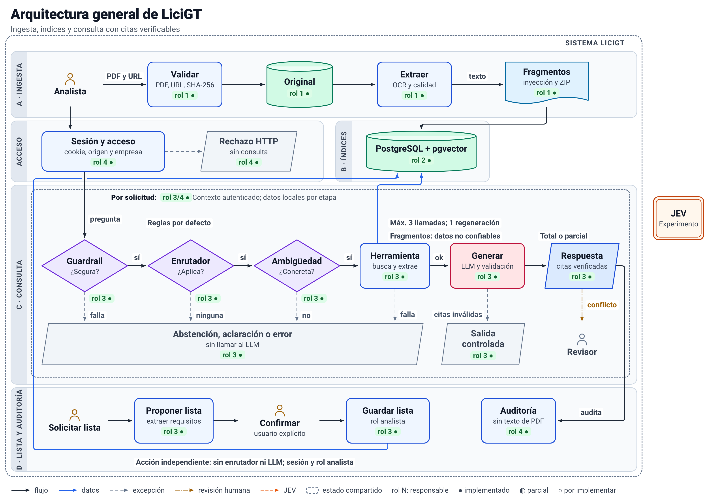
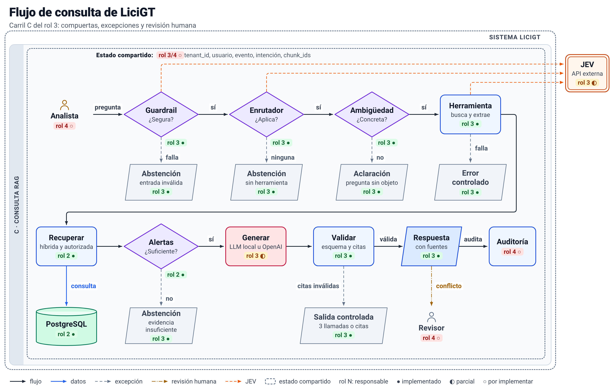

<!--
Formato para `pandoc -t pptx` (make presentacion-pptx). Aquí se permite un `#` por diapositiva
porque pandoc usa los encabezados de nivel 1 como títulos de diapositiva; las notas del orador
van entre `::: notes` y `:::`. Las rutas de imagen son relativas a docs/presentacion.
Cifras del reporte data/plataforma/reporte/20261119T061552Z.md y de docs/informe/Documento_tecnico.md.
-->

# LiciGT: RAG para licitaciones de medicamentos del IGSS

- CC3103 (UVG)
- Edwin Jose 22809
- Gustavo Cruz 22779
- Josue Say 22801
- Mathew Cordero 22982
- Noviembre de 2026

::: notes
Presentación del proyecto. El analista de una empresa proveedora del IGSS cruza bases, cronograma y modificaciones a mano; el error caro es usar una fecha o un requisito que ya cambió. El cliente es la empresa proveedora; el IGSS es la fuente.
:::

# Hipótesis y alcance

- Un RAG especializado reduce el tiempo de identificar requisitos sin perder precisión ni trazabilidad.
- Toda afirmación lleva cita: documento, página y versión.
- Sin evidencia, abstención; ante conflicto, revisión humana.
- Corpus: 5 licitaciones de medicamentos, 6 PDF.
- Fuera de alcance: presentar ofertas, decidir la vigencia, certificar cumplimiento.

::: notes
Se plantea la hipótesis y sus límites. El sistema ayuda a leer, no decide: nunca dice qué documento está vigente ni certifica cumplimiento.
:::

# Arquitectura general

::: notes
Cuatro carriles, uno por rol. La recuperación es híbrida (vectores y texto) con reranking sobre PostgreSQL. Las tres herramientas solo leen. JEV queda fuera del límite del sistema. Puntos: Cuatro carriles: ingesta, recuperación, consulta y plataforma. PostgreSQL con pgvector y búsqueda de texto; híbrida con reranking. Tres herramientas de solo lectura. JEV fuera del límite del sistema.
:::

# Flujo de una consulta

::: notes
Recorrido de una pregunta. Antes de publicar, un validador determinista comprueba las citas; si falla, hay una regeneración y luego salida controlada. La auditoría no guarda texto de PDF ni datos personales. Puntos: Guardrail, enrutador, herramienta, recuperación, generación. Validador determinista de citas, una regeneración y salida controlada. Auditoría sin texto sensible.
:::

# Decisiones clave (1): confianza

- Seleccionar, no generar: el modelo elige literales y el validador comprueba cada cita.
- Abstención ante evidencia insuficiente.
- Revisión humana ante conflicto.
- Nunca se decide qué documento está vigente.

::: notes
Cinco porqués encadenados, de dato equivocado a validador determinista: la confianza no descansa en el modelo sino en una comprobación que no es probabilística.
:::

# Decisiones clave (2): acceso y enrutador

- Tenant desde la sesión firmada, nunca de la pregunta ni del modelo.
- Seguridad por fila como segunda barrera; la API sin superusuario.
- Enrutador por reglas; en 60 casos, aciertos: reglas 37, JEV 53, LLM local 51.
- Errores críticos: 6, 0 y 0.
- Regla de adopción fijada antes de medir: P95 total mayor que 15 s, no se adopta. Fechas: JEV fuera.

::: notes
Dos barreras de aislamiento. JEV y el LLM local mejoran el enrutamiento (McNemar p = 3,1·10⁻⁵ para JEV), pero la regla fijada de antemano exige P95 dentro de 15 s y no se cumple, así que el sistema entregado usa reglas.
:::

# Demostración: evento 222-IGSS-2023

- Nueve pasos: login, cita con página, conflicto, abstención, página 4.
- Lista de verificación con confirmación.
- Inyección, otra empresa, lector.
- Rótulo con commit, fecha y condición de GPU.

::: notes
Video grabado de la demo (el curso pide demostración en vivo; se confirma con el docente). Los cortes de espera llevan el rótulo con la latencia real.
:::

# Evaluación: recuperación

- Tres bancos: desarrollo 27, rol 3 con 23 y común con 20 casos.
- Desarrollo: Hit@5 de 0,560 a 1,000; MRR@5 de 0,330 a 0,900.
- Rol 3: Hit@5 de 0,667 a 1,000.
- Común: Hit@5 de 0,625 a 0,875; MRR@5 se mantiene en 0,51.

::: notes
Comparación de línea base contra recuperación mejorada. En el banco común la mejora de Hit@5 no es significativa (McNemar exacto p = 0,125) y no hay ablación.
:::

# Evaluación: de punta a punta

- Cumplen 19 de 23 (rol 3) y 11 de 20 (común).
- Citas válidas: 41 de 41; JSON válido en todos los casos.
- Abstención correcta: 13 de 14 y 4 de 4.
- El validador comprueba existencia y texto, no que la cita respalde la afirmación.
- Métricas humanas (fidelidad, cobertura, tiempo de revisión): [pendiente].

::: notes
Resultados medidos tal cual. Corrida oficial con la GPU de escritorio compartida: el LLM generó a 62,5 tokens por segundo de mediana. Como referencia, una corrida previa a 86 tokens por segundo dio P95 de 18,5 s; no es resultado, solo muestra la sensibilidad al hardware.
:::

# Latencia, costo y condición de GPU

- P95: 32,0 s con 1 usuario y 37,5 s con 5; meta 15 s, no cumplida.
- Condición: corrida oficial con GPU de escritorio compartida, 62,5 tokens por segundo de mediana.
- Referencia: 86 tokens por segundo con P95 18,5 s; no es resultado.
- Costo: 0 en dinero; 0,75 llamadas y 3 938 tokens de entrada por consulta.
- Recuperación en GPU (cuda, fp16): búsqueda de 13,6 s a 0,21 s.

::: notes
La causa de fondo es la generación del LLM local de 9B con un solo hueco en llama-server. La asociación con la carga de la GPU no se aisló con un experimento. No se demostró que con la GPU libre se cumpla la meta.
:::

# Seguridad: 8 de 8

- Inyección directa e indirecta, cita falsa, requisito fabricado, acción no autorizada.
- Acceso cruzado, mezcla de eventos, original sin permiso.
- 102 fuentes revisadas, 0 violaciones de aislamiento.
- No implica seguridad universal.

::: notes
Suite de ocho pruebas con amenaza, mitigación y resultado. Todas cumplen, pero acotado a lo probado.
:::

# Limitaciones

- P95 sobre la meta; modelo local de 9B que se abstiene más de lo deseable.
- Banco común 11 de 20; bancos pequeños; cinco licitaciones.
- Página 4 sin indexar y anexo no publicado.
- Pendientes de revisión humana: fidelidad, cobertura de requisitos y tiempo de revisión: [pendiente].

::: notes
Se reportan sin maquillar. Las metas del anteproyecto sin medida quedan como [pendiente].
:::

# Roles y uso de IA

- Rol 1 ingesta, rol 2 recuperación, rol 3 consulta, rol 4 plataforma y evaluación: [integrante] en cada uno.
- Agentes con papeles separados: implementador, adversario, proponente y revisor de otra familia de modelos.
- Adjudicación humana de los desacuerdos.

::: notes
Completar los nombres según docs/roles/Asignacion_de_roles.md. La IA se usó con papeles separados y los desacuerdos entre proponente y revisor los adjudicó una persona.
:::

# Conclusiones y cierre

- Trazabilidad: toda cita publicada pasa el validador.
- Aislamiento por dos barreras; suite de seguridad 8 de 8.
- Faltan: latencia bajo 15 s y la evaluación con humanos.
- Siguiente paso: acortar la evidencia al LLM y reaplicar la regla de adopción de JEV.
- "El sistema no decide cuál está vigente."

::: notes
Cierre: el sistema cumple trazabilidad y aislamiento; falta la latencia y la evaluación con humanos. Preguntas.
:::
